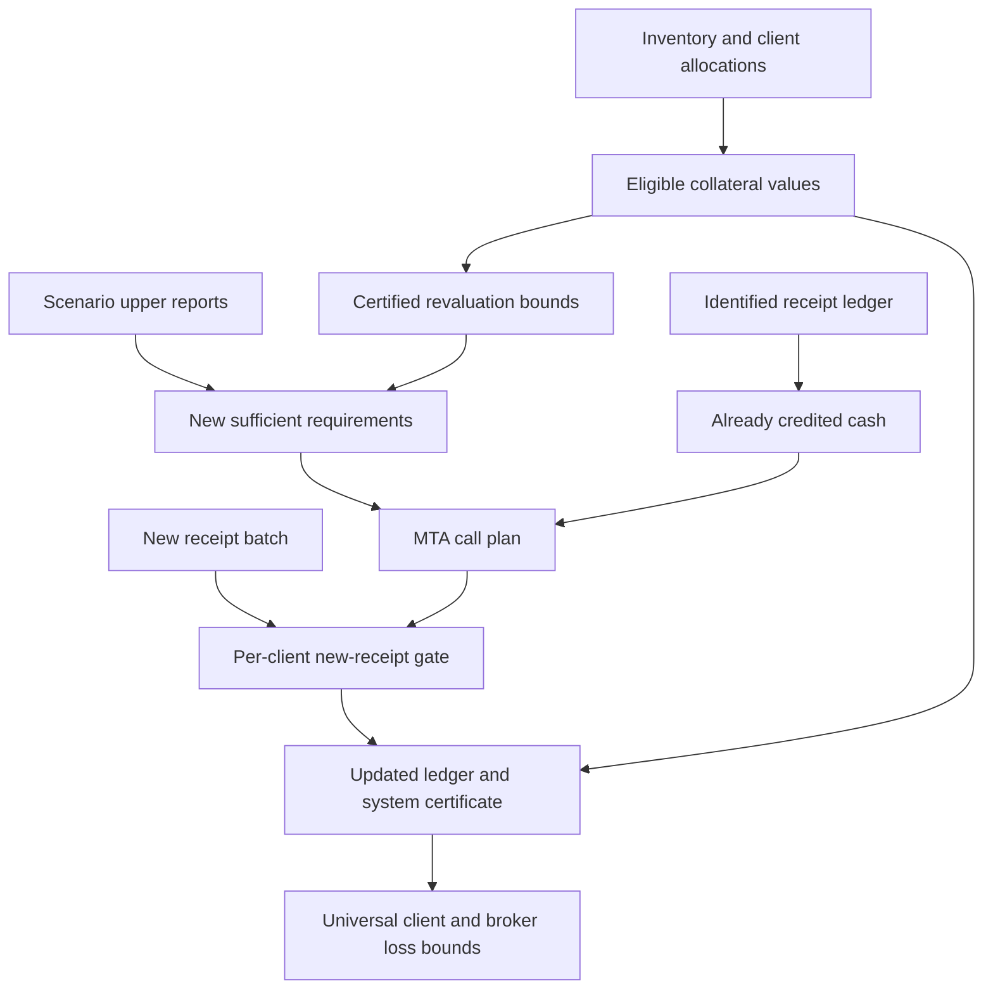

# Broker margin machinery and correctness

This is a progression of **eight generic, checked margin systems**. Each stage
adds a financial or operational feature and proves the guarantee that survives
it. There are no market scenarios, sample portfolios, calibrated haircuts, or
numerical regulatory limits in this folder. The inputs are arbitrary client
netting sets, Cauchy-real claim and collateral profiles, and explicit model
certificates.

The final [controller](Stage08Controller.agda) connects valuation, collateral
allocation, calls, and receipt processing. If newly credited receipts meet each
client's computed request, then at every admissible state:

```text
positive unsecured claim of client i ≤ minimum transfer tolerance i
sum of client unsecured claims       ≤ sum of those tolerances
modeled closeout loss                ≤ sum of those tolerances
```

The loss inequality holds for **every** supplied default/recovery severity in
`[0,1]`, independently for every client and state. With zero transfer tolerances,
all client claims are covered and both broker residual exposure and modeled
closeout loss are zero. Replaying receipt IDs preserves the entire certified
state. These statements scale to arbitrary finite numbers of clients, collateral
assets, catalogued receipt IDs, and message batches, over an arbitrary admissible
state domain; that domain need not be finite.

## Reading the progression

| Stage | New machinery | Main correctness statements |
| --- | --- | --- |
| [01 Cash](Stage01Cash.agda) | One signed replacement claim and available cash; separate call calculation and receipt update. | The call is the least nonnegative payment giving coverage. Receiving payments composes; remaining calls obey the positive-part update law. Budget and coverage propositions are equivalent and joined by a univalence path. |
| [02 Scenarios](Stage02Scenarios.agda) | Arbitrary admissible states; sufficient real requirements and rational lower/upper reports. | Upper reports guarantee coverage; lower reports are necessary for every nonnegative real budget. A rational assessment returns certified, deficient, or undetermined. Coincident bounds give a complete coverage decision. |
| [03 Netting sets](Stage03NettingSets.agda) | Any finite collection of separately authorized client netting sets. | Whole-book coverage implies zero aggregate residual and zero loss for every severity. Assessment finds a provably deficient client before returning inconclusive. Exact reports give a complete whole-book coverage decision; lower requirements bound total necessary cash. |
| [04 Collateral](Stage04Collateral.agda) | Asset inventory, allocations, conversion prices, and eligibility/haircut retention factors. | Assignments cannot exceed supplied inventory. Eligible value is nonnegative, at most market value, and in aggregate at most inventory value. A substitution preserving each client's eligible value preserves coverage, even with a different asset count. |
| [05 Journal](Stage05Journal.agda) | Immutable identified receipts; a ledger and arbitrary batches of event IDs. | Duplicate processing is idempotent; order and batching preserve balances. New cash is counted once per ID and credited only to its owner. Final cash equals prior cash plus newly credited cash. |
| [06 Revaluation](Stage06Revaluation.agda) | Changed claim/collateral profiles, bounded claim increases and collateral decreases. | Old sufficient cash plus the two drift reserves covers the new profile. Without additional cash, a previously covered book has residual/loss bounded by the reserve. Consecutive drift bounds compose without an independence assumption. |
| [07 Calls](Stage07Calls.agda) | A minimum transfer amount (MTA) for each client and sufficient rational requirements. | After requests are received, residual is bounded by MTA per client and in aggregate. Zero MTA restores full coverage. Requirements may be conservative; no exact real minimum is required. |
| [08 Controller](Stage08Controller.agda) | Composition of reports, inventory, revaluation, MTA policy, and actual journal updates. | A decidable per-client receipt gate returns a proof-bearing system certificate or a client whose plan remains unfulfilled. The certificate covers actual resulting balances, all admissible states and all severities. Inventory and extra cash back aggregate eligible value; replay preserves ledger plus proof. |

[REFERENCES.md](REFERENCES.md) maps these stages to primary literature and
explains the difference between a source's financial motivation and the exact
mathematical specification proved here. [PROGRESS.md](PROGRESS.md) records
implementation, reviews, and compiler validation.

## What the controller actually composes

For a client `i`, let `X₀(s,i)` and `X₁(s,i)` be old and new replacement claims,
and `C₀(s,i)` and `C₁(s,i)` the eligible collateral values. Positive claims are
owed to the broker. A label is one legally authorized netting set; two sets of
the same client must retain separate labels if their claims cannot be netted.
All values use one common unit of account.

An old report supplies a nonnegative rational upper requirement `u(i)` with

```text
X₀(s,i) ≤ C₀(s,i) + u(i)             for every admissible s
```

This is a statement about a sufficient requirement, not a claim that it was
already paid. Revaluation supplies nonnegative real bounds `a(i)` and `d(i)`:

```text
X₁(s,i) ≤ X₀(s,i) + a(i)
C₀(s,i) ≤ C₁(s,i) + d(i)
a(i) + d(i) ≤ r(i)                  certified rational reserve
```

The new sufficient requirement is `q(i) = u(i) + r(i)`. The controller proves
`X₁(s,i) ≤ C₁(s,i) + q(i)`. Correlated changes in claims, conversion prices,
and retention factors are permitted; the bounds must hold jointly at each
admissible state. Neither the report nor the reserve is claimed minimal.

If `p(i)` is already credited journal cash and `t(i) ≥ 0` the MTA, the call is

```text
gap(i)     = max(q(i) - p(i), 0)
request(i) = 0       when gap(i) ≤ t(i)
             gap(i) otherwise
```

The equality convention is explicit: a gap equal to MTA is left outstanding.
Above MTA the full gap is requested. This is a minimum-transfer tolerance;
it is not an additional unsecured credit threshold. No automatic return of
excess collateral, withdrawal, receipt reversal, or release policy is included.

For a batch of received event IDs, `newlyPaid` ignores duplicates within the
batch and IDs already in the ledger. The gate requires

```text
request(i) ≤ newlyPaid(oldLedger, batch, i)     for every client i
```

The journal accounting theorem gives `p′(i) = p(i) + newlyPaid(...,i)`. The
controller then proves coverage to tolerance using **`C₁(s,i) + p′(i)`**.
Generating requests by itself changes no balance. A failed gate proves that a
plan remains unfulfilled; with conservative requirements it need not imply an
unsafe account. Stage 02/03's exact-report coverage decisions are stronger,
and are available when the required exactness certificates can be supplied.



## The main theorem interface

Import the final stage directly:

```agda
import Cubical.HITs.CauchyReals.Example.Financial.Broker.Stage08Controller as Broker
```

Instantiate `Broker.Controller` with the state domain, an inventory-backed
allocation, old/new valuation and claim functions, and an immutable receipt
catalog. Its nested `Policy` takes the old reports and certified revaluation
reserve. The principal exported statements are:

| Name inside `Controller.Policy` | Contract |
| --- | --- |
| `requirements-cover` | The composed rational requirements suffice at the new valuation. |
| `plan`, `plan-nonnegative` | Executable requests computed from currently recorded balances. |
| `PlanSettled` | Each client's newly credited receipts meet that client's request. |
| `actual-cash-dominates` | Actual final cash is at least the hypothetical cash after paying the request. |
| `controller-correct` | `PlanSettled` constructs `Controlled` for the ingested ledger. |
| `settle` | Decides plan completion, returning its proof and `Controlled`, or a client with insufficient new receipts. |
| `zero-mta-book-guarantee` | Completed zero-MTA plans give full per-client coverage, zero residual, and zero loss for all severities. |
| `effective-collateral-backed` | Sum of eligible collateral plus recorded cash is at most inventory market value plus that cash. |
| `positive-claims-backed` | For a controlled ledger, sum of positive claims is at most those resources plus total MTA. Negative claims cannot offset another client's positive claim. |
| `controlled-replay`, `controlled-same-events` | Transport all safety evidence across replay or batches with the same event-ID set. |
| `controlled-isProp`, `certified-state-replay` | Control evidence is propositional; the ledger together with its certificate is equal after replay, even if its proof is independently reconstructed. |

`resources` includes unallocated inventory and is a valuation upper bound.
It is not a liquidity or solvency certificate, and its aggregate inequality
cannot replace the per-client coverage conditions.

The separate [Broker.agda](../Broker.agda) entry point exports all eight stages
under qualified stage names. [Theory.agda](../Theory.agda) includes it in the
`Broker` namespace. No stage imports a concrete financial example.

## Constructive and Cubical techniques

The financial profiles use the library's higher-inductive Cauchy reals, with
constructive order, lattice operations and finite sums. Universal coverage
consumes explicit bounds; it does not enumerate an infinite state domain or
choose a maximizing state. A finite scenario fold supplies sufficient margins
without requiring an attaining index.

Decisions compare rational reports and payments only. An arbitrary real
minimum is not assumed rational or decidable. A lower/upper gap is represented
honestly as uncertainty. No missing analysis result, postulate, excluded middle,
or unsafe option is added.

Stage 01 uses univalence to identify equivalent policy propositions and
propositional proof fields to construct paths of accounts. Stage 04 turns
equal eligible-value policies into an equivalence and a path of coverage types.
Stage 05 uses function extensionality to prove equality of whole ledgers, not
just equality of a selected balance. Stage 08 transports dependent certificates
along these paths and proves equality of ledger/certificate pairs. These
results allow certified state representations to change while retaining proofs.

## Input obligations and scope

The formal guarantees are conditional on the supplied model data and proofs:

- Claim functions, admissible states, upper reports, and drift bounds describe
  the intended valuation and stress policy. An empty admissible domain makes
  universal statements vacuous; the library does not certify stress adequacy.
- Asset labels denote distinct inventory pools. Allocation proofs prevent
  over-assignment of each modeled pool; they do not authenticate custody or
  establish enforceable rights. Prices include conversion to the common unit;
  retention lies in `[0,1]` and may depend on client and state.
- A credited event represents an actual nonnegative additional cash receipt
  belonging to the catalogued netting set. Its cash remains available at par
  and is excluded from the base collateral inventory. Distinct IDs represent
  distinct receipts. Reusing an ID cannot credit twice, but two IDs for one
  physical payment cannot be detected from this model.
- The catalog is finite and immutable during a run. Arbitrarily long batches
  may mention its IDs; dynamic catalog extension, banking authentication,
  persistence and crash recovery are separate integration problems.
- The loss is severity-weighted positive unsecured replacement exposure.
  Settlement principal risk, funding liquidity, liquidation execution,
  dispute resolution and FX payment-versus-payment are not subsumed by it.
  The existing `Instruments/` and `Settlement/` theories remain separate.

A swap portfolio may supply the claim functions, as in the earlier broker
example, but this progression requires no particular instrument representation.
It formalizes margin mechanics rather than regulatory compliance or a calibrated
initial-margin methodology.

## Validation

```sh
agda-codex Cubical/HITs/CauchyReals/Example/Financial/Broker.agda
agda-codex Cubical/HITs/CauchyReals/Example/Financial/Theory.agda
agda-codex Cubical/HITs/CauchyReals/Example/Financial.agda
```

The first command checks the staged progression. The other entry points check
integration with the reusable theory and the pre-existing examples. See the
[progress record](PROGRESS.md) for the final results.
