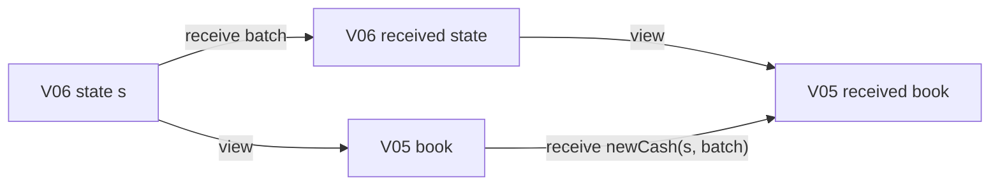

# One margin engine, seven versions

Speaker guide for a 28-minute session with quant developers. The audience knows
cash, collateral, exposure, and APIs; no prior dependent-type experience is
assumed. Present the same operations throughout: **quote a call, receive actual
cash, retain a guarantee about the resulting state**. Each version changes one
business requirement and proves how the earlier behavior survives.

The code is generic. Use the symbolic clients, scenarios, and amounts below;
there are no market observations, calibrated stress parameters, or concrete
portfolio examples in this presentation.

## Running order

| Time | Screen | Question answered |
| --- | --- | --- |
| 0–2 min | Opening contract | What exactly does a successful margin operation establish? |
| 2–5 min | [V01Account](V01Account.agda) | How much additional cash covers one claim? |
| 5–8 min | [V02Clients](V02Clients.agda) | Can the same operation cover every separate client? |
| 8–11 min | [V03Stress](V03Stress.agda) | Can one call survive every supplied stress? |
| 11–15 min | [V04Rational](V04Rational.agda) | How can an executable gate work with arbitrary real valuations? |
| 15–18 min | [V05Tolerance](V05Tolerance.agda) | What guarantee remains when small transfers are suppressed? |
| 18–22 min | [V06Receipts](V06Receipts.agda) | What happens when receipt messages are replayed? |
| 22–25 min | [V07Revaluation](V07Revaluation.agda) | What survives a change in market valuation? |
| 25–28 min | Final contract and boundaries | Which conclusion follows, and from which inputs? |

For a 25-minute slot, shorten the opening and omit the optional Cubical details
at V01 and V04. For 30 minutes, use the remaining time for questions. Keep order
and addition proof bodies collapsed; the interesting code is the state,
operation, theorem type, and connection to the preceding version.

## Opening: a state change with a contract

Say: “We will evolve one margin engine without losing track of what a receipt
means. Every successful result describes the state after actual cash arrives.
Later versions add clients, stress, an executable policy, receipt identity, and
revaluation.”

Explain three terms once. A **state** contains the financial data and evidence
that eligible balances are nonnegative. A **proof argument** supplies a required
precondition. A **proof result** establishes the postcondition for the particular
state produced by an operation. State indices keep these connections visible in
the API.

Amounts and valuations live in the library's Cauchy reals, written `ℝ`. They are
mathematical reals with constructive operations and proofs. Finite scenario
indexing does not make their numerical values rational or make every comparison
decidable. The rational policy boundary will appear in V04.

## V01 — one account

**Business change.** Start with a signed replacement claim and nonnegative
available cash. Define the additional requirement as
`quoteCall = max(claim − cash, 0)`. Quoting a call leaves the account unchanged.
`receive` adds actual available cash.

**Code change.** Show `State`, `Safe`, `quoteCall`, and `receive` in
[V01Account](V01Account.agda). `Safe b` means `claim b ≤ cash b`.

**Proof change.** Put this actual theorem type on screen:

```agda
receive-correct : ∀ b paid paid₊ →
  quoteCall b ≤ᵣ paid → Safe (receive b paid paid₊)
```

Read it left to right: “For any account and any nonnegative receipt, evidence
that the receipt covers the quote produces evidence that the resulting account
is covered.” `paid₊` is the nonnegativity proof. The expression inside `Safe`
is the actual transition result, so the postcondition refers to that state.

Then show `quote-least`: any nonnegative receipt that makes the account safe
must cover this quote. Together with `receive-correct`, this establishes the
exact least additional requirement. `remaining-quote` gives the familiar
remaining-gap formula after a partial receipt.

**Compatibility anchor.** This is the baseline contract. `receive-compose`
already connects two receipts with their combined amount. Later versions retain
this economic meaning while changing how a receipt is represented.

Optional Cubical detail: `adequate≃safe` packages the two directions as an
equivalence; `policy-path` uses univalence to identify the two proposition types.
The audience can understand the contract before seeing its proof construction.

## V02 — one engine across clients

**Business change.** Maintain separate client netting sets. Each client's call
must be covered by that client's cash; aggregate surplus does not discharge an
unrelated client's unsecured claim.

**Code change.** `State clients` holds claim and cash functions indexed by
`Fin clients`. `view b client` exposes precisely the V01 account for that client.
`quoteCall` and `receive` operate pointwise.

**Proof change.** `receive-correct` now concludes `Safe` for every client.
`safe-residual-zero` proves that summed positive unsecured claims vanish.
`safe-loss-zero` covers every supplied severity vector, whose entries lie in
`[0,1]`. The severity-weighted loss is a conditional closeout-loss model; the
theorem does not estimate a default probability.

**Previous compatibility.** Open `quote-refines-V01` and
`receive-refines-V01` in [V02Clients](V02Clients.agda). Both state that viewing a
client agrees with running the original operation on that account. These are
proofs about all inputs, including the proof-bearing account state.

Speaker transition: “We have lifted the same operation across clients. Next we
require each client's one cash amount to work across several market states.”

## V03 — one call across stress states

**Business change.** Claims and eligible collateral vary across a
nonempty finite family of supplied scenarios. Recorded cash is common to the
scenarios. Collateral excludes that separately recorded cash.

**Code change.** `Market clients stresses` has `Fin (suc stresses)` scenarios.
`view b scenario` exposes the V02 book at a scenario. For each client, the quote
is the maximum positive shortfall across this family, including existing cash.
The scenario values remain arbitrary Cauchy reals.

**Proof change.** `receive-correct` establishes simultaneous coverage in all
supplied scenarios. `quote-least` proves the least nonnegative uniform receipt,
per client. `snapshot-quote≤uniform` relates each scenario's requirement to the
uniform quote. `safe-loss-zero` quantifies over every scenario and every
admissible severity vector.

**Previous compatibility.** In [V03Stress](V03Stress.agda),
`receive-refines-V02` shows that receipt and scenario projection commute.
`singleton-quote-refines-V02` recovers the preceding quote when the market has
one scenario. The change to a uniform quote is therefore visible and bounded by
an explicit regression theorem.

Stress the scope: the theorem covers every member of the supplied finite family.
Arbitrary real scenario values do not turn it into a theorem about all possible
future market states. Universal scenario constraints follow the interpretation
of robust feasibility described in
[the robust optimization reference](../Broker/REFERENCES.md#robust-optimization).

## V04 — a rational policy around real valuation

**Business change.** An operational gate needs decidable amount comparisons.
Keep real valuation and add a supplied rational upper bound on its current
incremental requirement.

**Code change.** Show `Report b` in [V04Rational](V04Rational.agda):
`amounts` is a nonnegative rational vector, and `dominates` proves
`V03.quoteCall b client ≤ rat (amounts client)`. The state `b` appears in the
report's type. A report for an old state needs a proof-backed update or transport
before it can be used for a different state.

Explain the accounting point slowly: **the quoted requirement is incremental;
existing cash has already been included in V03's state.** Do not subtract the
entire cash balance again. `advanceReport` subtracts only the new receipt and
uses `max(oldUpper − newReceipt, 0)` to produce a report for the new state.

**Proof change.** `receive-correct` composes the rational report's bound with the
actual receipt. `assess` decides whether every rational receipt meets its
reported amount. Success carries coverage evidence. `unmet-quote` identifies an
unmet conservative plan; it does not prove economic undercollateralization.
The real requirement can be smaller than its rational upper bound.

**Previous compatibility.** `receive-refines-V03` states that a rational receipt,
embedded into the reals, performs the same economic transition. When a separate
`Exact` witness is supplied, `adequate≃safe` and `assessExact` recover the stronger
equivalence between the amount gate and economic coverage.

Say: “The executable boundary is deliberate. We decide rational policy amounts
and prove their connection to real-valued risk.” For rational market profiles
and rational existing cash, the generic `RationalInputs` module computes
`initialReport`; `initialReport-exact` proves it exact. This provides an initial
report factory without choosing concrete scenarios. Arbitrary real-valued
inputs retain the report interface and its supplied bound proof.

## V05 — minimum transfer amounts

**Business change.** Suppress small transfers. The policy requests zero when the
current report amount is at most the client's nonnegative MTA; otherwise it
requests the entire reported amount. The equality boundary belongs to the
zero-transfer branch.

**Code change.** `quoteCall b report mta` applies this policy. `receive` and
`advanceReport` are inherited from V04. In particular, suppressing a request
does not silently credit cash.

**Proof change.** In [V05Tolerance](V05Tolerance.agda), `receive-correct` concludes
`Bounded` after an adequate actual receipt: each scenario/client positive
unsecured amount is at most that client's MTA. `Guarantee` adds aggregate
residual and every-severity loss bounds by the sum of MTAs. The postcondition has
changed from full coverage to a quantified tolerance.

**Previous compatibility.** `receive-refines-V04` preserves the transition.
`zero-mta-refines-V04` identifies the quote exactly with V04's quote when every
MTA is zero; `zero-mta-safe` restores full coverage.

The [dated BCBS–IOSCO reference](../Broker/REFERENCES.md#bcbs-iosco-2020)
motivates minimum transfers. The full-gap-or-zero rule, its boundary convention,
and the proved residual bound are explicit choices of this engine; no regulatory
threshold is selected here.

## V06 — identified actual receipts

**Business change.** Receipt delivery can be repeated or reordered. Cash must be
credited by the identity of the underlying receipt, not by counting messages.

**Code change.** [V06Receipts](V06Receipts.agda) carries a market and a seen-event
ledger. The event catalog fixes each ID's owner and nonnegative rational amount.
`view` derives the V05 book using per-client paid balances from that ledger.
`newCash` uses the journal's `newlyPaid`, which excludes IDs already credited.
`advanceReport` uses these newly credited amounts. `process` returns the actual next state, a path proving it is the receipt
transition result, this valid next report, and an assessment. Even an `unmet-quote` assessment retains
the actual partial receipt and advances the report; it does not undo received
cash.

**Proof change.** `receive-correct` obtains the V05 per-client, aggregate, and
every-severity bounds when the new unique receipts meet the current quote.
`receive-replay` and `receive-commutes` give paths of complete market-and-ledger
states. `certified-state-replay` includes the dependent `Guarantee` as well,
regardless of how its proof was rebuilt. This theorem pairs the state with its
risk guarantee; the updated report is produced separately by `advanceReport`.

**Previous compatibility.** `receive-refines-V05` identifies the ledger-backed
transition with the V05 transition receiving exactly `newlyPaid`. This is the
connection that makes the existing financial proof reusable.



The two routes give equal V05 states by `receive-refines-V05`.
Compatibility is stated for these projected ledger states: their recorded cash
is rational, while their market valuations remain arbitrary Cauchy reals.

Say: “Identity changes the accounting boundary. Financial correctness follows
through a path between the two state representations.” Cubical equality allows
dependent evidence to move along this path; propositional order proofs do not
create an extra economic difference between equal states.

The [FINOS event model](../Broker/REFERENCES.md#cdm-event-model) motivates the
separation of business event identity from message delivery, and
[Saltzer, Reed, and Clark](../Broker/REFERENCES.md#saltzer-1984) motivate duplicate
suppression at the application boundary. The immutable catalog is a premise.
Distinct IDs must denote distinct actual receipts; neither bank authentication
nor network exactly-once delivery follows from this pure ledger model.

## V07 — revaluation without discarding receipt history

**Business change.** Claims and eligible collateral change after a report was
prepared. Already received cash remains received, but the old risk certificate
needs a justified update.

**Code change.** [V07Revaluation](V07Revaluation.agda) changes the market while
preserving the ledger. Inside `Engine catalog`, show `Update s`, `revalue`, and
`refreshReport`. The update pairs `nextMarket` with `drift`, a nonnegative
rational `reserve`, and `reserve-bound`.

For each client, the supplied nonnegative real bounds `a` and `d` satisfy, in
every scenario,

```text
newClaim ≤ oldClaim + a;
oldEffectiveCollateral ≤ newEffectiveCollateral + d;
a + d ≤ rat(reserve).
```

Effective collateral includes the same preserved recorded cash on both sides.
`refreshReport` sets the new upper amount to `oldUpper + reserve`.

**Proof change.** The result type of `refreshReport` establishes that the new
report bounds the revalued state's incremental real requirement.
`receive-correct` then invokes the same V06 guarantee. `process` returns the
assessment and next valid report for a further cycle. `zero-mta-safe` and
`zero-mta-loss-zero` expose full coverage and every-severity zero loss at zero
tolerance. Existing cash is accounted for through the preserved ledger, so it
is not deducted twice.

**Previous compatibility.** With an unchanged market and zero reserve, the
`unchanged` update and `quote-refines-V06` identify the quote with V06's quote;
`receive-refines-V06` identifies its receipt transition. Show
`revalue-preserves-ledger` and `receipt-replay` to connect revaluation with the
retained history. `certified-state-replay` carries the complete state and risk
guarantee across a receipt replay after the update.

The [margining and gap-risk reference](../Broker/REFERENCES.md#brigo-pallavicini-2014)
motivates making adverse change explicit. This version proves deterministic
sufficient bounds under supplied drift hypotheses. It does not calibrate a
margin period of risk, derive a default model, or prove that the reserve is least.

## Final contract: what the composed engine establishes

Use this notation, with no particular numerical inputs. Let `j` range over the
finite clients and `s` over the nonempty finite scenarios. At the current market,
let `X(s,j)` be the signed claim, `C(s,j) ≥ 0` the eligible collateral excluding
recorded cash, and `cash(L,j) ≥ 0` the cash derived from ledger `L`. Define

```text
r(j) = max over s of max(X(s,j) − C(s,j) − cash(L,j), 0).
```

A valid current report provides rational `u(j) ≥ 0` and a proof
`r(j) ≤ rat(u(j))`. Given rational tolerances `m(j) ≥ 0`, its request is

```text
call(j) = 0       if u(j) ≤ m(j)
          u(j)   otherwise.
```

For any finite batch of catalog IDs, let `p(j)` be the amount newly credited to
client `j`, excluding previously seen and repeated IDs. If every `p(j) ≥ call(j)`,
and `L′` is the resulting ledger, then

```text
for every s and j:
  0 ≤ max(X(s,j) − C(s,j) − cash(L′,j), 0) ≤ rat(m(j));

for every s and every severity vector θ with 0 ≤ θ(j) ≤ 1:
  0 ≤ Σ_j θ(j) · max(X(s,j) − C(s,j) − cash(L′,j), 0)
    ≤ Σ_j rat(m(j)).
```

The aggregate positive unsecured exposure satisfies the same upper bound.
When every tolerance is zero, all client claims are covered and every such
severity-weighted closeout loss is zero. This is a universal statement over the
supplied scenario family and severity vectors, without a probability-of-default
model.

Revaluation makes a new valid report from certified adverse-change bounds and
then reuses this contract. Replaying a batch cannot create additional paid cash;
the associated certified state is preserved through the replay path.
The code anchors for this final result are `Engine.receive-correct`,
`Engine.zero-mta-loss-zero`, and `Engine.certified-state-replay` in
[V07Revaluation](V07Revaluation.agda).

Close by locating the boundary precisely. This theorem depends on valid
valuations, eligible available collateral, correctly assigned actual receipt
identities, the supplied scenarios, and any supplied drift bounds. Receipt cash
must be additional to collateral already counted in the market. It does not
establish legal netting rights, authenticated bank receipts, settlement-principal
protection, currency-specific funding, durable concurrent storage, or production
throughput. The cited financial literature supplies motivation, not a claim of
regulatory compliance.

## Rehearsal and verification

Open each file by its linked name and search for the theorem names above; these
anchors are stable as proof bodies change. For the live code tour, keep one
operation and its compatibility theorem visible together. Show compiler checking
as checking the stated generic contracts, and avoid presenting it as a financial
calibration or performance benchmark.

From the repository root, these commands check the baseline, the rational
boundary, and the final import chain using the configured wrapper:

```sh
agda-codex Cubical/HITs/CauchyReals/Example/Financial/Broker2/V01Account.agda
agda-codex Cubical/HITs/CauchyReals/Example/Financial/Broker2/V04Rational.agda
agda-codex Cubical/HITs/CauchyReals/Example/Financial/Broker2/V07Revaluation.agda
```

These are suggested commands, not a record of checks or mutation tests
performed by this document. Record an actual compiler result when demonstrating
it.
