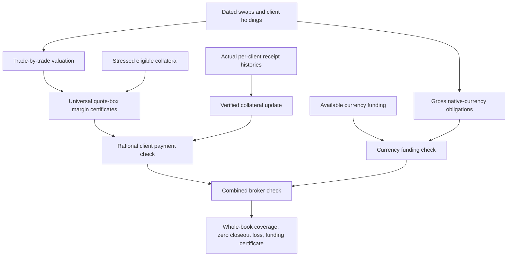

# System correctness: motivating financial examples

For presenting the development to quantitative developers, use
[Broker2: one engine evolved](Broker2/README.md) and its
[speaker guide](Broker2/PRESENTATION.md). Seven versions keep the same
quote/receive contract visible and prove compatibility as clients, stress,
rational execution, tolerances, receipt identities and revaluation are added.

The separate [generic broker progression](Broker/README.md) now develops these
ideas through eight stages without concrete scenarios. Its
[controller theorem](Broker/Stage08Controller.agda) composes inventory-backed
collateral, revaluation reserves, minimum transfers and identified receipt
processing. Fulfilled calls bound all client residuals and every modeled
closeout loss; zero tolerance gives full coverage. Replaying receipt IDs
preserves the whole certified state. The scenario-specific results below
remain independent applications.

The motivating result is a broker control program whose successful output
implies a statement about its entire modeled swap book. The development also
contains a trading solver whose failure proves that no competing real portfolio
can meet its budget. These statements connect executable decisions to portfolio
valuation, collateral state, risk, and settlement obligations.

The main entry points are
[BrokerGuarantees](Examples/FX/BrokerGuarantees.agda) and
[TradingGuarantees](Examples/Portfolio/TradingGuarantees.agda).
Their reusable components are [Margin/Workflow](Margin/Workflow.agda) and
[Margin/PaymentHistory](Margin/PaymentHistory.agda).

## Broker: a certified control for a whole swap book

Two clients hold opposite portfolios of deliverable FX swaps with foreign
notionals 60 and 40. Valuation includes spot and both discount factors; client B
posts foreign collateral whose eligible domestic value moves with spot. The
broker also owes the actual four far-leg currency exchanges at date 30.

The program receives nonnegative rational cash receipts by client and rational
available funding balances by currency. Its exact certificates cover **every
Cauchy-real quote** in the box

```text
spot ∈ [0.8, 1.2]
domestic discount ∈ [0.9, 1]
foreign discount  ∈ [0.9, 1]
```

The headline theorem `broker-ready≃requirements` states:

```text
brokerReady(receipts, funding) = true
  iff
  every client's swap claim is covered at every admissible real quote
  and every gross outgoing currency obligation has sufficient funding.
```

`checkBroker` returns a decision carrying a proof of those requirements or a
proof that they do not all hold. Its computation consists of finite rational
comparisons; the whole-box guarantee comes from independently checked universal
margin certificates. The underlying client checker identifies a deficient
client when its coverage obligation fails. It does not select a violating
arbitrary real quote by classical choice.

`broker-end-to-end` then constructs `BookGuarantee` for the **trade-by-trade
swap portfolios**, with these three fields:

| Certificate field | Meaning |
| --- | --- |
| `swap-portfolios-covered` | Every client's actual two-swap valuation is covered at every quote in the box. |
| `every-closeout-loss-zero` | Aggregate modeled closeout loss is zero for every quote and every admissible scenario-dependent default/recovery severity. |
| `gross-settlement-funded` | The four actual far-leg instructions have enough gross funding in each native currency. |

Severity may depend jointly on client identity and market state. No independence
assumption or probability-of-default estimate is needed. The theorem permits
all clients to default with zero recovery; sufficient available collateral
covers the modeled positive replacement claims even in that realization.



### A complete margin collection example

The joint box requires total additional collateral, relative to the initial
collateral model, of 25 for A and 108/5 = 21.6 for B. Their older single-factor
calls, 15 and 68/5 = 13.6, have already been received. The new requests are 10
and 8. The additional receipts below are processed sequentially by the existing
`recordPayment` operation, with a theorem connecting its reports to the
whole-box checker.

| Input to the broker control | Executable result | Checked implication |
| --- | --- | --- |
| Receipts (15, 13.6), funding (100, 100) | Refused | Old single-factor payments do not cover the joint box. |
| Receipts (25, 21.6), funding (100, 100) | Ready | Whole-book `BrokerGuarantee`. |
| A receives 15 then 10; B receives 13.6 then 8; funding (100, 100) | Ready | `staged-broker-guarantee` for the sequentially updated collateral state. |
| All 46.6 cash units credited to A and none to B | Refused | Equal aggregate cash does not imply client-by-client coverage. |
| Correct client receipts, funding (200 domestic, 0 foreign) | Refused | Equal reference base value does not fund the required foreign payments. |

These labels are Agda reduction proofs (`refl`), not manually assigned expected
outcomes. `same-total-cash` and `same-base-funding-value` prove the equal totals
in the last two comparisons, so the failures isolate the client and currency
constraints rather than a simple shortage of aggregate value.

`eighteen-is-least-further-cash` proves that **every** nonnegative real further
payment vector covering all actual swap claims has total at least 18.
`requests-componentwise-minimal` in the reusable workflow proves the stronger
per-client lower bounds. `request-cycle-ready` proves that receiving the
computed requests completes the margin gate for any previously received
nonnegative client balances, provided the separate funding gate is met.
The total is a sum of segregated client requirements, not a pooled broker
risk measure or permission to transfer one client's collateral to another.

### Arbitrary payment histories and representation independence

[PaymentHistory](Margin/PaymentHistory.agda) operates on arbitrary finite lists
of nonnegative rational receipts. Its collateral fold works over **any scenario
type**, including the entire real FX state domain. The main invariant is

```text
sequentially credited collateral = original collateral + total receipts
processed outstanding call       = max(original call - total receipts, 0).
```

`processHistory-batch` identifies the complete sequential exact report with a
single batched update after transporting it to the same collateral state.
`processHistory-same-total` and the batch-swap theorem show the same result for
histories with equal totals. Equality includes the proof-bearing report, not
only its numeric amount. Rational report uniqueness and proposition-valued
proof fields justify this cubical transport.

In the broker application, `history-end-to-end` transports the entire book
certificate to the actual sequential collateral function, for arbitrary
histories of both clients. `history-reports-agree` links each iterative report
to the outstanding request used by the universal-domain workflow.
`history-batching-invariant` proves that equal **per-client** totals preserve
the complete broker decision with the same funding balances.

These results assume a fixed valuation model and eligible received domestic
cash throughout a history. They do not cover withdrawals or revaluation between
steps. A receipt is mathematical input representing money actually received;
there is no event-ID deduplication or bank/custodian connection. Recording the
same receipt twice credits it twice.

### What scales, and what is supplied

`CertifiedClients` is parameterized by **any finite number of client netting
sets** and an arbitrary admissible scenario domain. Its theorems quantify over
all clients, all admissible states, all allowed severity functions, and all
nonnegative real further-payment competitors. Receipt histories have no fixed
length. The two-client FX book is a concrete instantiation of this reusable
interface. No throughput, memory benchmark, or production deployment is claimed.

Each client supplies an exact rational margin amount together with a proved
`MarginCertificate` for its scenario domain. The finite construction and the
joint FX box both supply such certificates. The checker does not construct
exact rational certificates for every arbitrary real dataset.

The available-collateral and funding inputs must have their stated meaning:
client netting must be authorized, collateral must be realizable and available,
and the independent currency balances must not double-count that collateral.
The formalization checks the consequences of these inputs, not custody or legal
facts. Sources motivating these distinctions are recorded in
[REFERENCES.md](REFERENCES.md#bcbs-settlement-2013); quote bounds and haircuts
remain synthetic model inputs.

The combined check certifies **margin coverage and gross funding**. Settlement
principal risk requires an additional delivery condition. If each actual
exchange satisfies the supplied `AtomicBook` payment-versus-payment law,
`closeout-and-principal-zero` proves that the sum of modeled closeout loss and
settlement principal loss is zero. The check does not establish that protocol
law or actual settlement completion, and the theorem does not assert that all
market, operational, or funding costs vanish.

## Trading: complete feasibility against real portfolios

[TradingGuarantees](Examples/Portfolio/TradingGuarantees.agda) strengthens the
existing fee-aware optimizer into a certified feasibility solver.
For every rational nonnegative fee parameter `s` and rational budget `b`,

```text
solve(s, b) succeeds
  iff there exists a real two-asset holding u with sum(u) = 1
      whose actual all-in loss is accepted at budget b.
```

Competitors are arbitrary Cauchy-real holdings, including short positions.
`holdings-complete` proves that the optimizer's parameterization represents
every such vector. `execution-implementation` connects its loss formula to
`TransactionCosts.allInLoss`, including the actual proportional fee definition.

The `execute` branch returns `ApprovedTrade`: a normalized long-only allocation,
nonnegative fee rates, acceptance of its actual all-in loss, an exact rational
optimal CVaR, and a lower bound against every real competitor and threshold.
The `reject` branch returns `AllRejected`, refuting acceptance for **every**
normalized real competitor. Rejection therefore establishes global infeasibility
for this problem, not merely failure of the chosen allocation.

`solver-pass≃feasible` identifies the program's Boolean success with the
propositionally truncated existence statement. `solver-policy-path` uses
univalence to make these certificate interfaces interchangeable. Given merely
truncated feasibility, `reconstructTrade` computes the canonical approved order
without selecting a hidden existential witness.

| Fee and budget | Result |
| --- | --- |
| Fee 1, budget 2 | Executable rejection and a proof of impossibility for all real normalized holdings. |
| Fee 1, budget 9/4 | Executable success, allocation (3/4, 1/4), actual fee 1/4, globally least CVaR 9/4. |

Completeness here is for the supplied two-asset, four-scenario, uniform 50%-tail
market and proportional-cost model. Fees enter losses; a self-financing execution
ledger is not included. The feasibility predicate does not also impose a mean,
worst-case stress, or funding constraint. The separate
[stress-constrained example](Examples/Portfolio/StressConstrainedTrade.agda)
shows why such constraints must be stated explicitly: at fee 1 and raw stress
cap 3, the least CVaR becomes 19/8, so budget 9/4 is infeasible. Optimizer
uniqueness is not claimed.

## Theorem map and validation

| Property to cite | Module and named result |
| --- | --- |
| Broker decision exactly matches universal margin and funding requirements | `BrokerGuarantees.broker-ready≃requirements` |
| Success protects actual swap claims against all modeled closeout realizations | `BrokerGuarantees.broker-end-to-end` |
| Arbitrary receipt histories preserve that whole-book guarantee | `BrokerGuarantees.history-end-to-end` |
| Minimum extra cash after the older payments | `BrokerGuarantees.eighteen-is-least-further-cash` |
| Client/currency accounting cannot be replaced by aggregate values | `misallocated-cash-refused`, `wrong-currency-funding-refused` |
| Generic client workflow is sound, complete and produces minimal requests | `Margin.Workflow.CertifiedClients` |
| Sequential and batched updates give equal proof-bearing reports | `PaymentHistory.processHistory-batch`, `processHistory-same-total` |
| Trading success exactly means real portfolio feasibility | `TradingGuarantees.solver-pass≃feasible` |
| Trading failure rules out every competitor | `TradingGuarantees.failure-certificate` |

```sh
agda-codex Cubical/HITs/CauchyReals/Example/Financial/Theory.agda
agda-codex Cubical/HITs/CauchyReals/Example/Financial.agda
```

All proofs use the existing safe Cubical Agda foundations. No additional
analysis assumptions, postulates, arbitrary-real order tests, or optimizer
existence axioms are introduced. Final compiler outcomes and independent
reviews are recorded in [PROGRESS.md](PROGRESS.md).
